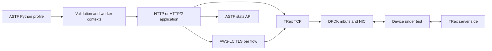

# Cisco TRex RFC 9411 Extension

**Native TLS, HTTP/2, and application latency measurements inside the TRex ASTF dataplane.**

Build reproducible network-security benchmarks with real encrypted connections,
validated HTTP responses, and latency statistics from the traffic being tested.
This project extends Cisco TRex's existing TCP/ASTF/DPDK path with AWS-LC and
nghttp2. TLS and HTTP/2 execute in the TRex process, on the flow's dataplane worker.

An independent community extension; not an official Cisco release or an RFC 9411
certification. The engine supplies building blocks for the methodology. See the
[scope and limitations](docs/rfc9411-scope.md) before interpreting benchmark results.

[Get started](docs/getting-started.md) · [Architecture](docs/architecture.md) ·
[Traffic workloads](profiles/rfc9411/README.md) · [Measurements](docs/measurements.md) ·
[Contribute](CONTRIBUTING.md)

## What you can test

| Capability | Implementation |
|---|---|
| TLS 1.2 and TLS 1.3 | Real client/server handshakes and authenticated application data through AWS-LC |
| Certificate policy | Server certificates, CA/hostname verification, server SNI checks, mandatory mTLS |
| TLS negotiation | Version-specific cipher selection, key-exchange groups, signature algorithms, optional ticket resumption |
| HTTP/1.1 and HTTPS | Opt-in status and response-completeness validation; persistent connections |
| HTTP/2 and HTTPS/2 | nghttp2 framing/HPACK, concurrent streams, flow control, ALPN, GOAWAY and timer-driven CC pacing |
| Cleartext HTTP/2 | Prior knowledge over TCP; no HTTP/1.1 Upgrade |
| TCP application latency | SYN-based TTFB/TTLB for validated HTTP connections, plus HTTP/1 transaction metrics |
| UDP transaction latency | Sequential request/response RTT, with timeout and completion accounting |
| Diagnostics | ASTF stats API, histograms, negotiated TLS counters, optional sampled C++ costs, text-only NIC capture |

No external proxy, socket-based TLS sidecar, QAT, crypto_mb, or kernel TLS path is
required. AWS-LC and nghttp2 are direct library dependencies. Existing ASTF
profiles keep their behavior unless the new features are enabled.



## Release and compatibility

- **Extension:** `1.0.0` — first public release.
- **Upstream:** TRex **v3.06**, commit `46be64bedbe9d505dfb55099c38119d6e86267ca`.
- **TLS backend:** AWS-LC **5.11.0**, shared libraries; OpenSSL is not an alternative backend.
- **HTTP/2:** a maintained nghttp2 development package exposing continuation limits.
- **Distribution:** nine unified-diff patches, grouped by subsystem. No TRex source fork,
  private keys, binary libraries, or diagnostic captures are vendored here.

The series applies directly to a **clean v3.06 checkout**. Apply the complete series once to the unmodified source tree. Arbitrary TRex master/main
revisions and newer tags are not yet supported.

## Start here

Obtain this repository, then prepare a separate TRex checkout:

```sh
git clone --branch v3.06 --depth 1 \
  https://github.com/cisco-system-traffic-generator/trex-core.git trex-core
python3 cisco-trex-rfc9411/tools/apply.py trex-core --check
python3 cisco-trex-rfc9411/tools/apply.py trex-core
```

Git is not required to apply the extension: a source archive and `patch -p1` are
also supported. The helper checks source hashes, dry-runs the entire series, and
verifies the resulting files. Continue with [dependencies, build, and first
traffic](docs/getting-started.md).

## Validation, without headline benchmarks

Validation covers TCP/ASTF/scheduler simulator tests, TLS and HTTP/2 protocol
tests, sanitizer/interoperability checks, standalone profiles and patch integrity.
The protocol implementation has 103 passing simulator regression tests and 45
passing profile scenarios, including CC holds and named template groups.

A complete build and physical-NIC qualification of the final release artifact
remain pending. These checks are not a capacity result or RFC certification.
[Validation details](validation/README.md) document the exact evidence and limits.

## Find your way around

| Directory | Purpose |
|---|---|
| [patches/](patches/README.md) | Ordered series, SHA-256 manifest, ownership by subsystem |
| [tools/](tools/README.md) | Apply, verify, regenerate, and repository checks |
| [docs/](docs/README.md) | Architecture, API, measurement semantics, RFC scope, maintainer workflow |
| [profiles/](profiles/README.md) | Ready-to-load CPS, throughput and CC workloads |
| [examples/](examples/README.md) | Guide to runnable profiles installed by the patches |
| [tests/](tests/README.md) | Repository tooling tests; engine tests install into TRex |
| [validation/](validation/README.md) | Sanitized results and release provenance |

## Help improve it

Useful contributions include independent interop testing, repeatable performance
measurements, review of resource ownership, and better orchestration/reporting.
Start with [CONTRIBUTING.md](CONTRIBUTING.md) and the
[source map](docs/architecture.md#source-map). Open an issue with a reproducer or
propose a focused pull request. Keep performance claims tied to the actual
profile, negotiated TLS parameters, hardware, and measurement interval.

## License and attribution

See [LICENSE](LICENSE) and [THIRD_PARTY_NOTICES.md](THIRD_PARTY_NOTICES.md).
Existing upstream file notices and component licenses remain applicable;
patch delivery does not relicense upstream Python or bundled dependencies.
Cisco and TRex names identify the project being extended and do not imply endorsement.
