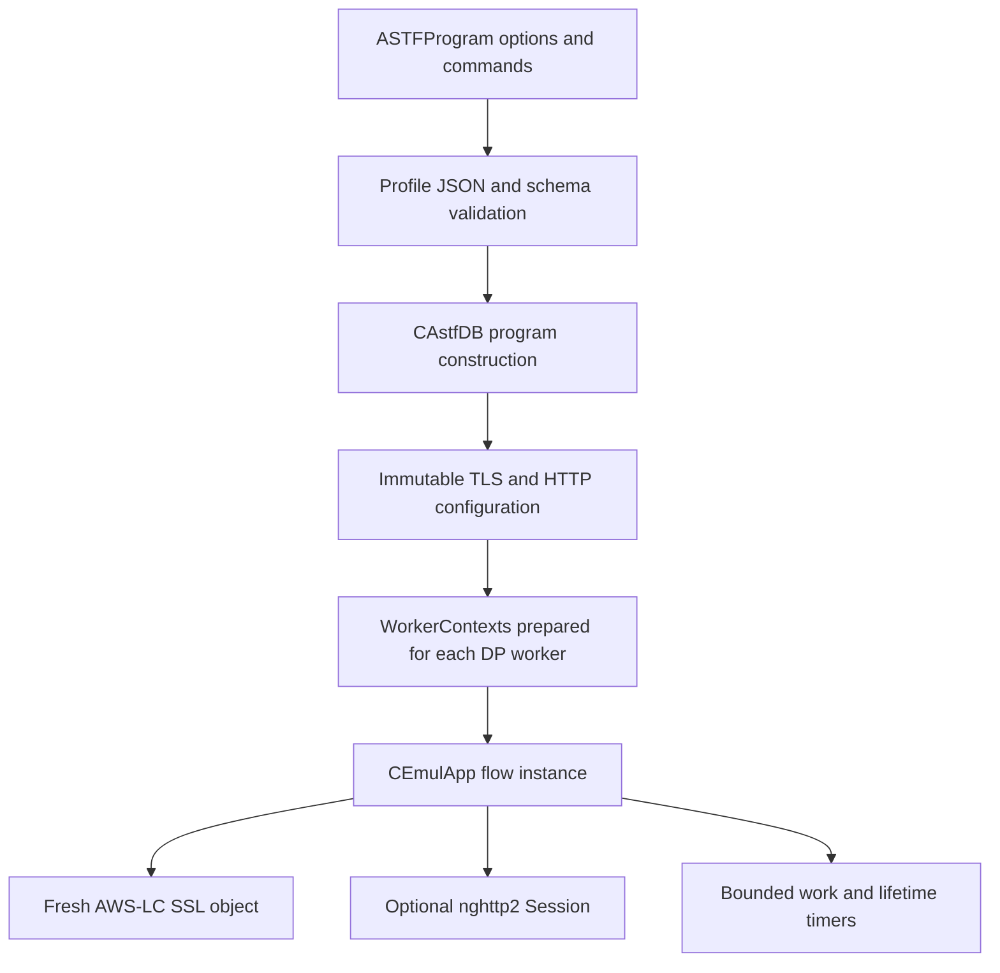
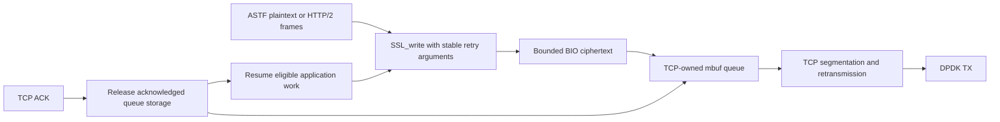
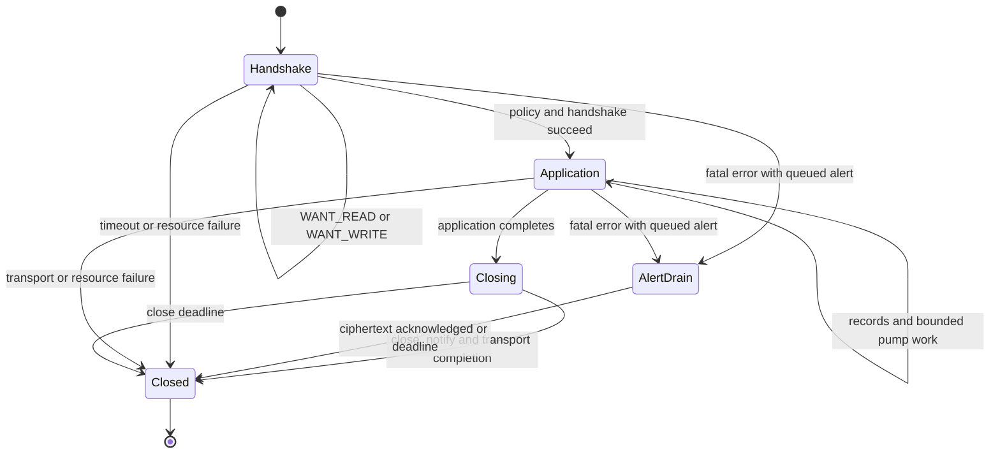
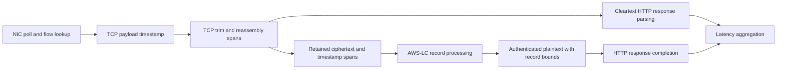

# Architecture

The extension adds application-layer state to ASTF flows while retaining TRex's
TCP stack, flow tables, timers, DPDK packet I/O, and worker ownership model.
It does not move TCP to VPP or Linux, and does not perform TLS through sockets.

## Control plane to dataplane

Certificates and policy are loaded during profile preparation. Errors roll back
partially built profiles. Worker-local contexts avoid sharing active TLS objects
across dataplane threads. Each flow owns a fresh SSL object; successful session
resumption does not mean reusing an SSL connection object. A bounded worker-local
BIO transport cache reuses storage, with reset and lifetime tests.

HTTP/2 owns its session command sequence. Ordinary ASTF byte programs remain
available for HTTP/1.1 and other applications. Validated HTTP/1.1 is opt-in;
`recv(N)` alone does not validate an HTTP status or measure an HTTP transaction.

## Transmit ownership and backpressure

Cleartext HTTP/2 bypasses TLS and feeds the same TCP transport integration.
The HTTP/2 output buffer remains stable until consumed. A blocked SSL_write must
be retried with the original data and length; read, handshake, and shutdown paths
respect that obligation. TCP retains ciphertext until acknowledged, so a BIO
read or NIC enqueue is not permission to free retransmission data.

This is **mbuf-friendly bounded buffering, not end-to-end zero-copy TLS**.
Plaintext assembly, BIO buffers, ciphertext copies, and reassembly have real
memory/CPU costs. Buffer exhaustion aborts the affected flow through explicit
resource paths rather than asserting the dataplane process.

## TLS lifecycle

WANT results express dependencies, not a request to busy-loop. Input, output
space, acknowledgements, and timers make work eligible again. Pump budgets bound
iterations; they do not preempt a single expensive cryptographic operation.
Crypto remains synchronous on the owning DP worker.

Fatal-alert drain stops application/TLS work, preserves the first failure, and
allows generated ciphertext to pass through TCP before disconnecting. It is
bounded by the existing close timeout; resource failure can end it immediately.
Error classification distinguishes a local certificate verification failure from
an unrelated protocol alert and from EOF without close_notify.

## Receive timestamps

Timestamp spans follow the bytes retained by the TCP overlap policy. Duplicate
segments cannot overwrite accepted timestamps. TLS uses record boundaries:
plaintext returned after authentication inherits the record's first arrival and
latest required fragment timestamps. It does not expose unauthenticated bytes
or pretend to map each plaintext byte exactly to an encrypted packet.

These are software observation points after NIC polling and flow lookup, not
hardware wire timestamps. See [measurement semantics](measurements.md).

## HTTP/2 and UDP

nghttp2 owns frame validation, HPACK, SETTINGS and flow-control state. The adapter
owns application stream accounting, response status checks, bounded output, and
latency publication. GOAWAY stops new requests while accepted streams drain;
refused/incomplete requests do not become successful measurements. ALPN must
actually select `h2` for encrypted sessions.

Client CC workloads use response-relative request intervals and a final hold. The
application timer wakes at the earlier of the next pacing boundary and the fixed
session deadline. ACK/work callbacks handle transport backpressure; no busy poll
is introduced while waiting. Default unpaced sessions retain their deadline timer
without repeated rescheduling. Final hold leaves RX-derived TTLB unchanged.

UDP RTT uses an explicit sequential `udp_request` command. It measures the next
received datagram after a request, without modifying the payload. It does not
supply request IDs or solve correlation for reordered/unsolicited datagrams.

## Scheduling and statistics

ASTF scheduling uses bounded catch-up and RX servicing under backlog. Explicit
scheduler overrides retain their meaning. No callback budget can create CPU
capacity: overload and test completion must still be reported honestly.

Data-plane counters are aggregated through ASTF statistics. Verbose TLS
negotiation diagnostics remain available via the API while the live table stays
compact. Optional cost probes count calls and sample elapsed time; nested timings
must not be added as independent costs. Concurrent snapshots are not transactional.

## Source map

Paths below refer to the **patched TRex tree**, not this patch repository.

| Component | Principal files |
|---|---|
| TLS policy, flow, tickets, retry handling | `src/44bsd/tls/astf_tls.{h,cpp}` |
| Bounded BIO and ciphertext helpers | `src/44bsd/tls/astf_tls_bio.h`, `astf_tls_mbuf.h` |
| HTTP/1 validation and transactions | `src/44bsd/http/astf_http.h`, `astf_http_transactions.h` |
| HTTP/2 state and stream callbacks | `src/44bsd/http2/astf_http2.{h,cpp}` |
| ASTF transport integration | `src/44bsd/tcp_socket.{h,cpp}` |
| Reassembly and timestamp ownership | `src/44bsd/tcp_input.cpp`, `rx_timestamp.h` |
| API/schema/loading | `trex_astf_profile.py`, `scripts/astf_schema.json`, `src/astf/astf_db.cpp` |
| Counters and RPC | `src/stt_cp.cpp`, `src/main_dpdk.cpp`, `src/astf/astf_cost_metrics.h` |
| Scheduler | `src/astf/astf_scheduler.h`, `src/bp_sim.cpp` |
| Regression tests | `tests/tls/`, `src/gtest/bp_tcp_gtest.cpp` |

The [patch map](../patches/README.md) identifies where each component is maintained.

## Transport-first TLS receive processing

See the [RX phase diagram](release-1.0.1.md#receive-path) and
[queue lifetime review](../validation/rx-queue-review.md) for the burst-local
transport/TLS split, capacity fallback and flow destruction rules.
