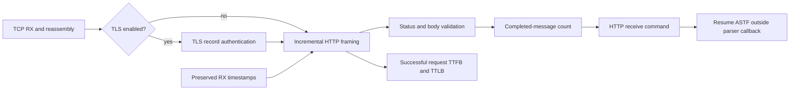

# HTTP/1.1 message-aware receive design

The HTTP/1.1 parser runs on the owning ASTF worker. It accepts ordered plaintext
from TCP, or from native TLS after record authentication. The ASTF program waits
for a complete message instead of a byte count. Rewritten header lengths and
chunk framing therefore do not change the point at which the next command runs.

Input may arrive while a send waits for its TCP acknowledgment or before a receive
command executes. The parser retains partial framing state and a bounded-by-profile
completion count. It does not retain whole response bodies. A receive consumes one
completion; it must not be combined with byte-count receives in the same program.
The ASTF interpreter's existing work budget limits immediate command progress.

A receive timeout starts when its command executes. Completion cancels that timer.
An absolute deadline is checked after each bounded timer slice, avoiding overflow
for long CC pauses. Parser errors terminate the affected exchange and do not add
successful response/TTLB samples. Flow destruction cancels application timers.

The server validates request framing; it is not a general HTTP server. It neither
routes requests nor constructs dynamic error pages. CONNECT, Upgrade and Expect
requests are unsupported. HEAD responses require an explicit program-wide option.
Content-Encoding is not decompressed. Pipelining and mixed GET/HEAD association
are outside this release's supported workload contract.

## Retained memory

The existing response parser and the new server request parser each reserve
`max_header_bytes + 1` bytes. The default is 16,385 bytes per enabled endpoint.
Enabling request parsing consequently adds roughly 1.53 GiB of header capacity
per 100,000 simultaneous server flows, before parser metadata and allocator
rounding. This capacity is not a claim about committed RSS. Body data is scanned
or skipped without a full-body allocation. Header scratch is not zeroed at flow
creation; only bytes already received are inspected.

## Compatibility

Existing `recv(N)` profiles retain their byte-count semantics. Message-aware
receive is an opt-in program change. HTTP/2, UDP RTT and TLS cryptography are
unchanged. The standalone HTTPS workload profiles opt into the new API; their
connection counts, request counts and intentional CC pauses remain unchanged.
