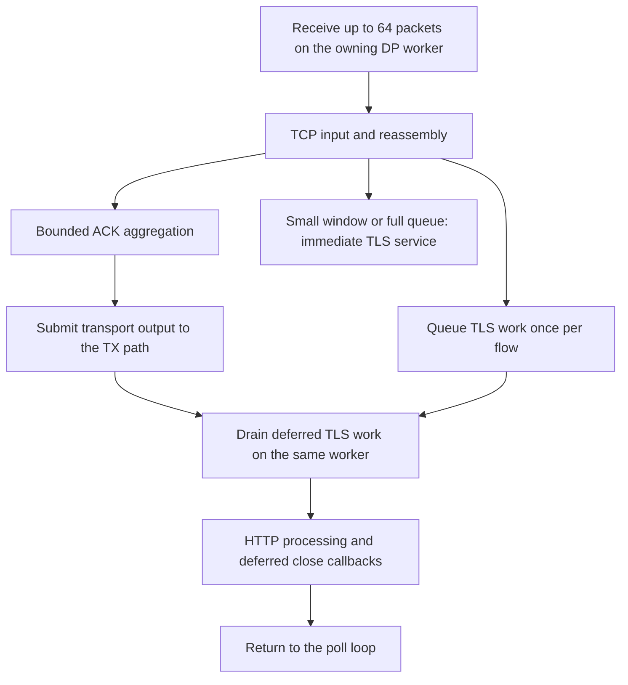

# Release 1.0.1

This release is based directly on 1.0.0 and the NIC-tested transport-first TLS
receive change. It does not incorporate the discarded intermediate release candidates.
AWS-LC, cipher policy, profile API and measurement definitions are unchanged.

## Receive path

The queues contain non-owning pointers. Flow destruction cancels both entries.
The TLS slot is cleared before invoking application work, which may close and
delete the flow. There are no additional worker threads or queue allocations.
ACK aggregation is bounded to approximately four MSS; control packets and
window reopening retain their immediate TCP paths. Newly consumed TLS receive
credit uses normal TCP window-update thresholds when already acknowledged.

## Observed physical-NIC result

One paired run used 32 DP workers, TLS 1.3, 45,000 configured CPS, ten 16 KiB
responses per connection, and an NGFW without TLS inspection. In the steady
30–290 second interval, reported CPU utilization fell from 86.84% to 68.03%.
Both runs completed 13.5 million connections and 135 million responses.
Average request TTFB/TTLB fell from 0.802/0.898 ms to 0.135/0.151 ms.
These are results for that workload, not a general capacity guarantee or an
independent hardware-timestamp validation of latency accuracy.

The TCP ACK counter increased by approximately 10.6% (it also includes some
FIN/ACK packets). The experimental run also
reported `tcps_rcvduppack`, with zero duplicate payload bytes and zero TCP data
retransmissions. An old-sequence empty TCP packet can increment this counter;
a local delayed empty-ACK test reproduces that behavior. A follow-up local reproduction found unnecessary repeated FIN during TLS
closure, consistent with these counters. This release includes the
[FIN correction and its regression tests](../validation/tls-fin-review.md);
its effect on the physical NIC remains to be measured.
No TLS/HTTP errors or `err_cwf` were observed in the paired runs.

The RX phase and timestamp code is byte-identical to the NIC-tested experiment.
The additional production change prevents unsolicited repeated FIN on TLS
connections; it is locally validated but not yet NIC-qualified. The full
release bundle has not received a separate multi-profile physical-NIC campaign.
See [validation](../validation/rx-queue-review.md).

## Installation

For clean TRex v3.06, apply the nine patches using the normal
[installation instructions](getting-started.md).

For an unmodified extension 1.0.0 source tree, use the
[incremental upgrade](../upgrades/1.0.0-to-1.0.1/README.md). Do not apply it on top
of the experimental patch or another development build. Use a clean source
tree for reproducible installation of the full bundle.

For an already installed RX experiment or the initial unpublished 1.0.1 bundle,
apply the [three-file FIN hotfix](../upgrades/rx-phases-fin-fix/README.md).
